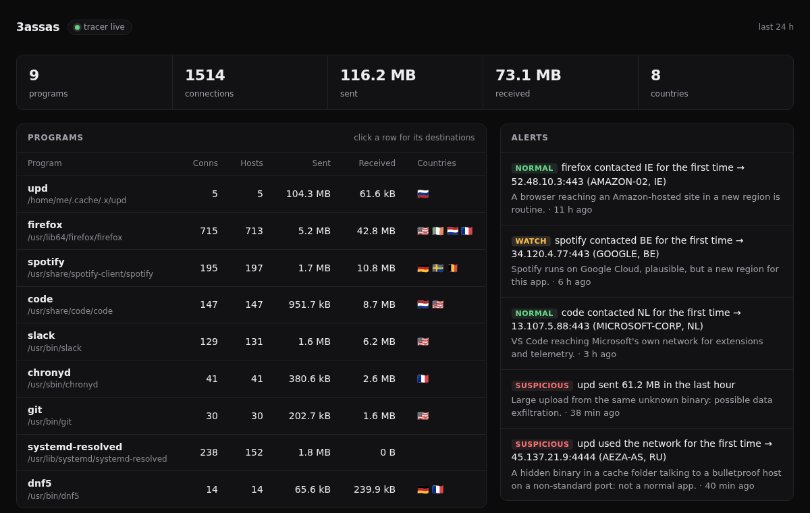
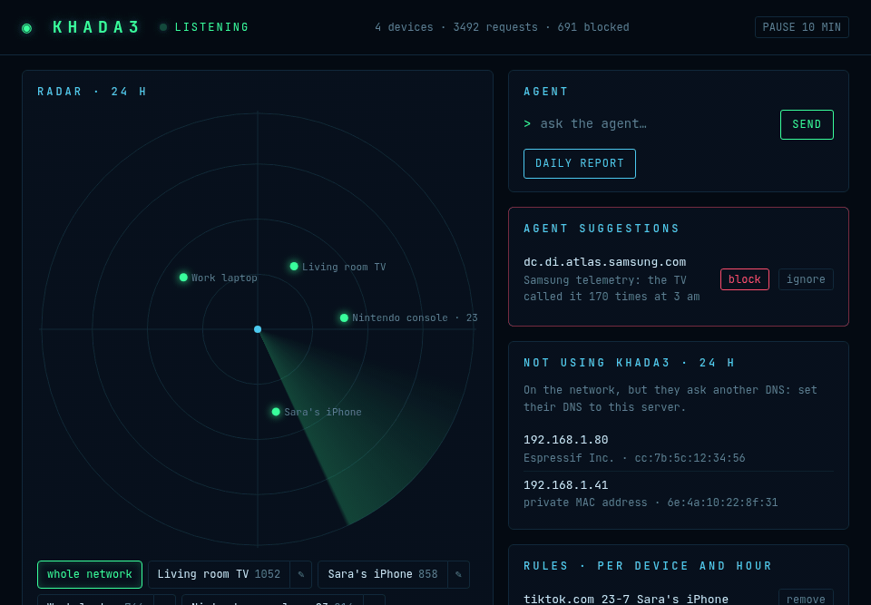
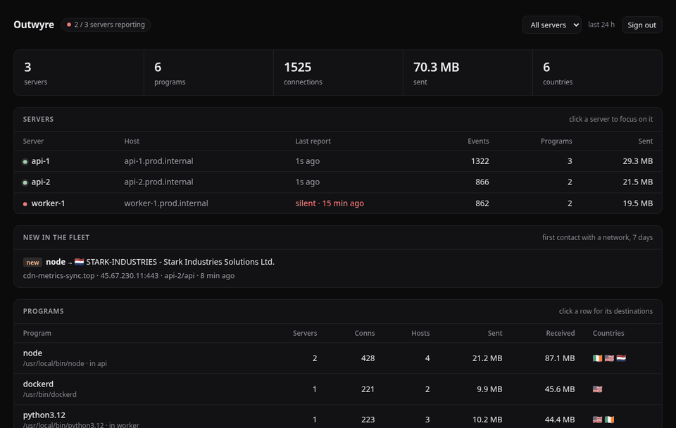

# onezdtr

*I build tools that show what your machines say behind your back.*

<table width="100%">
  <tr>
    <th width="50%" align="center"><a href="https://github.com/onezdtr/3assas">3assas</a></th>
    <th width="50%" align="center"><a href="https://github.com/onezdtr/khada3">khada3</a></th>
  </tr>
  <tr>
    <td width="50%" align="center"></td>
    <td width="50%" align="center"></td>
  </tr>
  <tr>
    <td width="50%" align="center">See which program on your Linux machine talks to whom, from inside the kernel, and cut it off in one command. eBPF hooks name every connection from the DNS answers, an LSM hook blocks a program live, a 24/7 agent has an AI judge every new connection. Measured overhead, one-line install. (C, Rust, Python) <a href="https://onezdtr.github.io/3assas/">Website</a> · <a href="https://github.com/onezdtr/3assas">Code →</a></td>
    <td width="50%" align="center">A home DNS server that shows who every device on the network talks to, blocks trackers, and has an AI agent that explains the day on Telegram. Runs on an old MacBook turned server. (Python) <a href="https://github.com/onezdtr/khada3">Code →</a></td>
  </tr>
</table>

<table width="100%">
  <tr>
    <th align="center"><a href="https://github.com/onezdtr/outwyre">Outwyre</a></th>
  </tr>
  <tr>
    <td align="center"></td>
  </tr>
  <tr>
    <td align="center">3assas for a whole fleet: one self-hosted dashboard that shows which program, in which container, on which server, talks to whom, and flags the first contact with a network nobody in the fleet ever used. Silent-server and Slack alerts. (Python, SQLite, Cloudflare Workers) <a href="https://outwyre.site-react.workers.dev">Website</a> · <a href="https://github.com/onezdtr/outwyre">Code →</a></td>
  </tr>
</table>

## Stack

<b>Languages</b>

<b>Tools &amp; infra</b>

Also: eBPF · libbpf · systemd · DNS · Tailscale · LLM agents · Gemini API · Telegram bots

